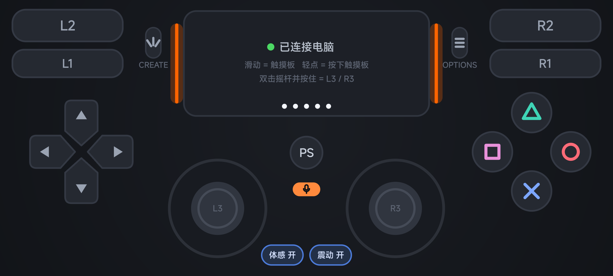

# 手机手柄（phone-dualsense）

这个 App 能把安卓手机变成一个有线连接的 PS5 手柄。手机用 USB 线连上电脑后，电脑上会多出一个 USB 设备 **DualSense Wireless Controller**（VID 054C / PID 0CE6）。按键布局和报告格式都照着 PS5 手柄做，Steam 和支持 PS5 手柄的游戏会直接把它当成 PS5 手柄。手机不需要 root。



## 下载

到 [Releases](../../releases) 下载 `phone-dualsense-pc-版本号.zip`，解压后里面有手机 App（`手机手柄.apk`）和电脑端脚本。只想要 App 的话，也可以单独下载 `phone-dualsense-版本号.apk`。

## 原理

没有 root 的安卓手机，系统不允许 App 把手机报成 USB 手柄。这里换了个办法：

- 手机 App 里跑一个 USB/IP 服务端，模拟一个完整的 USB DualSense，包括设备描述符、HID 报告描述符、特性报告（校准、配对信息、固件信息）和 64 字节的 0x01 输入报告。
- 电脑上的 adb 把这个服务端经 USB 线转发到电脑上：电脑的 32400 端口对应手机的 3240 端口。服务端只监听手机本机地址，Wi-Fi 上访问不到。
- 电脑上的 [usbip-win2](https://github.com/vadimgrn/usbip-win2) 驱动把它接成一个真正的 USB 设备，之后交给 Windows 自带的 HID 驱动处理。

电脑发回来的输出报告也会处理：游戏震动会变成手机马达震动，灯条颜色、玩家指示灯和麦克风灯会显示在手机屏幕上。

实测环境：Windows 11、usbip-win2 0.9.8.1、Steam，手机是 Mi 11（HyperOS 2.0，安卓 14）。Steam 用它自带的 PS5 驱动认出了手柄，加载了 PS5 的默认配置，还给手柄分配了玩家灯。

## 第一次使用

**电脑上（只做一次）**

1. 安装 usbip-win2：到 <https://github.com/vadimgrn/usbip-win2/releases> 下载 `USBip-版本号-x64.exe` 并安装。驱动有微软签名，不用开测试模式。安装时所有 USB 3.0 Hub 会重启，键盘鼠标会断开几秒。官方建议装之前先建一个系统还原点。
2. 脚本要用到 adb。第一次运行 `连接手柄.bat` 时，如果在 `电脑端\adb` 和系统 PATH 里都找不到 adb，脚本会问你要不要从 Google 官网下载 platform-tools（约 8MB），下载后放进 `电脑端\adb`。

**手机上（只做一次）**

1. 打开开发者选项。小米/红米：设置 → 我的设备 → 全部参数与信息 → 连点“OS 版本”7 次。其他品牌一般是连点“版本号”。
2. 在开发者选项里打开 **USB 调试**。小米/红米还要打开 **USB 安装**，脚本自动装 App 时会用到。
3. 插上 USB 线，手机弹出“允许 USB 调试吗？”时，勾选“始终允许”，再点允许。

## 每次使用

1. 手机插上 USB 线。
2. 双击运行 `电脑端\连接手柄.bat`。脚本会依次完成这几步：等手机连上，手机上没装 App 就自动装，打开 App，建立转发，接入虚拟手柄。小米手机自动安装时会弹出“是否允许通过 USB 安装”，要在倒计时结束前点“继续安装”。
3. 手机上显示“已连接电脑”就能用了。在 Steam → 设置 → 控制器里能看到 PS5 手柄。
4. 用完关掉手机 App，或者运行 `电脑端\断开手柄.bat`。

## 按键

| 手机屏幕 | 对应 PS5 手柄 |
|---|---|
| 左上两排 | L2（上）、L1（下）。手指可以在两排之间滑 |
| 右上两排 | R2、R1 |
| 左边十字键 | 方向键，支持斜方向，手指可以滑动换方向 |
| 右边四个键 | △ ○ × □。手指压在两个键中间时两个都按下 |
| 中间大方块 | 触摸板。滑动 = 触摸（支持两指）；轻点 = 按一下触摸板；按住不动半秒 = 按住触摸板 |
| 触摸板两侧小键 | Create（左）、Options（右） |
| PS | PS 键（Steam 里会打开 Steam 菜单） |
| PS 下面的小键 | 麦克风静音键 |
| 下方两个圆 | 左右摇杆。手指按下的位置就是中心，手指拉出圈外时中心会跟着移动 |
| 双击摇杆并按住 | L3 / R3 |
| 底部“体感”开关 | 用手机的陀螺仪和加速度计当手柄体感（Steam 的陀螺仪瞄准能用） |
| 底部“震动”开关 | 游戏震动和按键震动反馈 |

扳机 L2/R2 在手机上只有按下和松开两档，按下就是满行程 255。

## 常见问题

- **脚本停在“等手机插上 USB 线”**：手机没打开 USB 调试，或者没点“允许”。也可能是线的问题，换一根能传数据的线，有的线只能充电。
- **“接入虚拟 PS5 手柄”一直失败，报 `Incompatible USB/IP protocol version`**：这其实是说电脑连不上手机里的服务端，多半是手机上的 App 没开，或者被系统关掉了。确认“手机手柄”在手机前台、显示“等待电脑连接”，然后再运行一次脚本。
- **安装 App 时报 `INSTALL_FAILED_USER_RESTRICTED`**：小米弹出的“继续安装”没点，倒计时结束后被自动拒绝了。再运行一次脚本，盯着手机点“继续安装”。
- **手机上显示“端口 3240 打不开”**：手机上有别的 App 占用了这个端口。关掉 App 再打开。
- **小米手机三指滑动时截屏了**：在设置里关掉“三指下拉截屏”。
- **切到别的 App 以后手柄断了**：App 被系统关掉了。玩的时候让它留在前台，屏幕会保持常亮。

## 自己编译

不需要 Android Studio，也不需要 Gradle。下面的命令在 Windows 的 Git Bash 里运行：

```bash
bash setup-toolchain.sh   # 下载 JDK 17、build-tools 35.0.1、android-35 到 toolchain/（约 320MB 压缩包，解压后约 900MB）
bash build.sh             # 先跑协议测试，通过后打包出 手机手柄.apk
bash build.sh test        # 只跑协议测试
```

`setup-toolchain.sh` 会从微软和 Google 官网下载，并校验文件哈希。使用 Android SDK 代表你同意 [Android SDK 许可协议](https://developer.android.com/studio/terms)。第一次编译时，`build.sh` 会在 `keystore/` 里生成签名密钥。以后升级 App 要用同一个密钥，否则手机上会提示签名冲突。

不接手机也能在电脑上验证 Windows 和 Steam 认不认这个设备：

```bash
bash build.sh test
toolchain/jdk/bin/java -Dfile.encoding=UTF-8 -cp build/test PcHarness
```

然后另开一个终端，运行 `"C:\Program Files\USBip\usbip.exe" --tcp-port 32400 attach -r 127.0.0.1 -b 1-1`。电脑上会出现一个手柄，按键和摇杆会自己动。

## 文件说明

| 路径 | 内容 |
|---|---|
| `app/src/com/phonepad/ds/core/` | DualSense 描述符和报告格式、USB/IP 服务端（不依赖安卓，电脑上也能跑） |
| `app/src/com/phonepad/ds/` | 安卓界面、触控、体感、震动 |
| `app/res/`、`app/AndroidManifest.xml` | 图标和清单 |
| `电脑端/连接手柄.bat`、`断开手柄.bat` | 电脑上一键连接和断开 |
| `test/ProtocolTest.java` | 在电脑上模拟 usbip 客户端做协议测试（69 项） |
| `test/PcHarness.java` | 不用手机，在电脑上直接跑同一份服务端，用来测 Windows 和 Steam 的识别 |
| `build.sh`、`setup-toolchain.sh` | 编译脚本和工具链下载脚本 |

## 声明

本项目与 Sony Interactive Entertainment 没有任何关系。为了让 Windows、Steam 和游戏能识别，虚拟设备使用了 DualSense 的 USB 厂商/产品 ID 和设备名称。PlayStation、DualSense 是 Sony Interactive Entertainment 的商标。

报告格式参考了 Linux 内核的 `hid-playstation` 驱动和 SDL 的 PS5 驱动，USB/IP 协议参考了 Linux 内核文档 `usbip_protocol.rst`。

许可证：[MIT](LICENSE)
